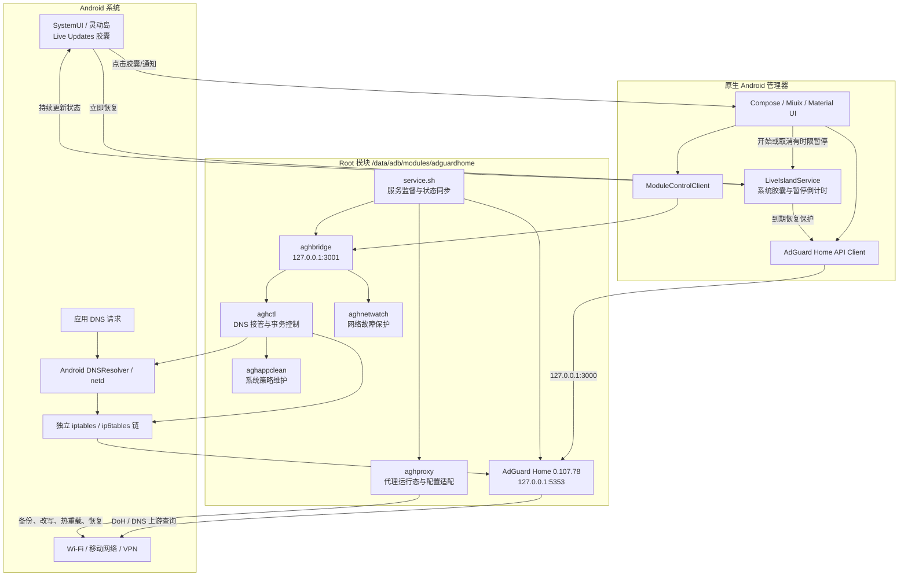
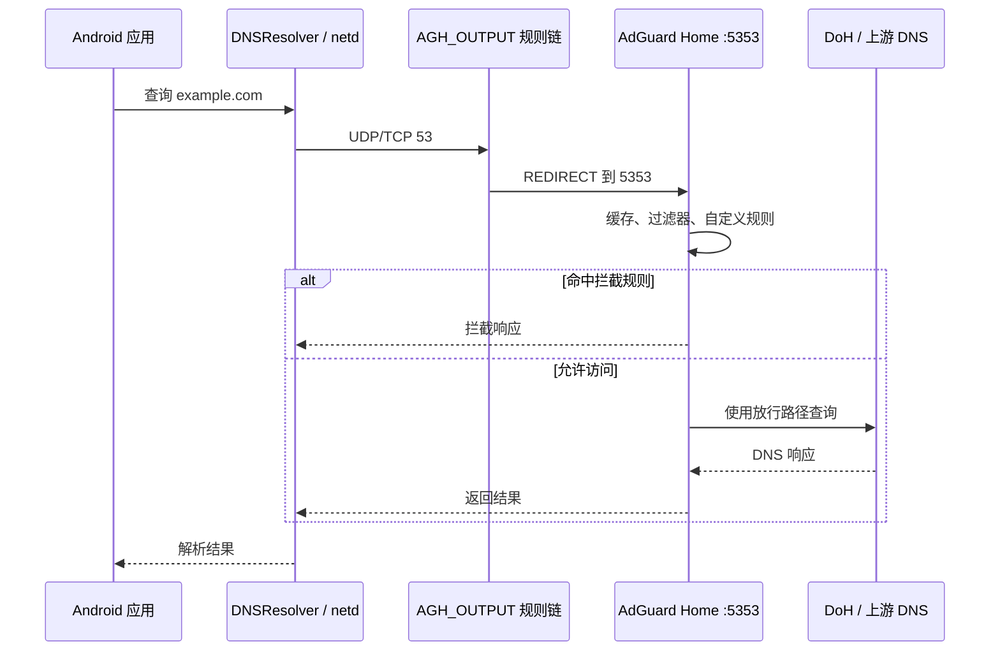
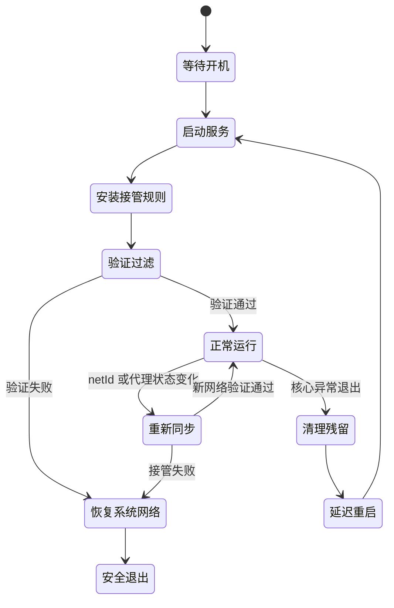
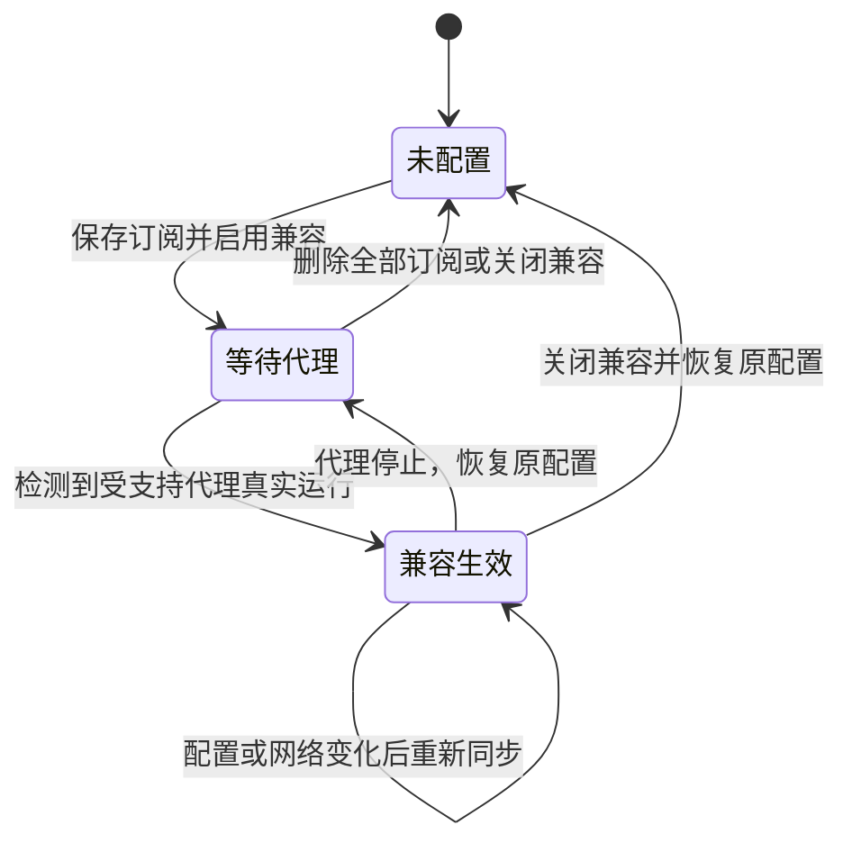

# AdGuard Home for Android

一个面向 `arm64-v8a` Android 设备的本地 DNS 过滤方案。项目将 AdGuard Home 作为 Magisk / KernelSU 模块中的常驻 DNS 服务运行，并提供原生 Android 管理器、受限特权控制桥、系统 DNS 接管、代理兼容、网络故障保护和完整恢复机制。

## 项目特点

- **系统级过滤**：通过 Android DNSResolver 与独立 iptables 规则链接管 DNS，不依赖 VPN 广告过滤应用长期占用 VPN 槽位。
- **本地闭环**：AdGuard Home、控制桥和默认规则均随模块提供，核心服务不依赖管理器保持前台或后台运行。
- **无需长期授予 App Root**：管理器通过只监听 `127.0.0.1:3001` 的原生控制桥提交白名单命令，特权操作由模块执行。
- **防环路设计**：上游 DNS、bootstrap 地址和本地回环流量分别处理，避免透明转发把 AdGuard Home 自己的上游请求重新送回本机。
- **网络切换可恢复**：按 Android `netId` 保存原 DNS，接管前后执行解析与过滤探测；失败时回滚，不把半完成规则留在系统中。
- **代理按需兼容**：只有保存了订阅且检测到受支持代理实际运行时才改写代理配置；代理停止后自动恢复正常过滤配置。
- **断网保护**：已连接 Wi-Fi 或移动网络持续约 10 秒未通过系统互联网验证时，先记录现场，再退出过滤并恢复系统网络；认证门户和部分连接网络不会误触发。
- **崩溃自愈**：服务监督器检测核心进程，先清理残留接管规则，再按退避策略重新启动。
- **可审计恢复**：安装时保存 IFW、私有 DNS和出厂自定义规则；卸载时恢复 IFW 与系统网络状态。
- **集中日志**：模块日志统一写入 `/data/adb/agh/logs`，管理器支持清理和打包导出。
- **系统灵动岛**：Android 16 / ColorOS 16 / HyperOS 2.0 下用系统 Live Updates 胶囊显示过滤状态与暂停倒计时，支持始终显示、暂停时显示、仅状态栏信息三种模式；旧系统退回普通常驻通知。

## 总体架构



### 组件职责

| 组件 | 职责 |
| --- | --- |
| `service.sh` | 等待开机完成、启动控制桥、监督 AdGuard Home、周期同步网络、维护日志、监听代理状态变化 |
| `aghctl` | 核心事务控制器；负责启动停止、DNSResolver 接管、iptables 规则、健康验证、网络恢复、日志导出 |
| `aghbridge` | ARM64 原生本地控制桥，仅监听回环地址，只接受预定义动作和受限参数 |
| `aghproxy` | 检测代理是否真实运行，扫描 YAML，备份并适配配置，触发热重载，关闭时恢复 |
| `aghappclean` | 维护私有 DNS 与 IFW 等系统策略；过滤运行期间每 60 秒执行一次 |
| `aghnetwatch` | 常驻网络观察进程；在符合条件的异常网络上触发现场快照和安全退出 |
| Android 管理器 | 展示状态、调用 AdGuard Home API、通过控制桥执行模块级操作 |
| `PauseCountdownService` | 在有时限暂停期间以前台服务维护倒计时通知，到期后通过本地 API 自动恢复保护 |

## DNS 过滤链路

运行时配置会将 AdGuard Home DNS 监听迁移到 `127.0.0.1:5353`，管理 API 默认监听 `127.0.0.1:3000`（可在管理器设置中修改）。Android DNSResolver 仍使用 `127.0.0.1:53`，再由模块规则重定向到实际监听端口。



DNS 接管按事务执行：

1. 识别当前有效物理网络或满足条件的 VPN `netId`。
2. 保存该网络原有 IPv4 / IPv6 DNS 与当前启动标识。
3. 创建独立规则链并安装透明转发规则。
4. 通过 Android DNSResolver helper 将对应网络指向本地 DNS。
5. 同时验证普通域名可解析、测试广告域名被阻断。
6. 任一步失败都会恢复原 DNS 并移除本次规则。

IPv6 环境会根据设备的 NAT 能力和网络 DNS 栈决定是否安装回落规则。IPv6-only 网络不会被强行套用仅适合双栈网络的 IPv4 回落策略。

## 启动、监督与断网保护



服务正常运行时每 5 秒执行监督，每两个周期同步一次网络状态。启动失败的重试间隔依次为 5、10、20、60 秒，避免高频重启占用系统资源。

网络故障保护只在以下条件共同满足时触发：

- Wi-Fi 或移动网络已经连接；
- 系统网络没有 `VALIDATED` 状态；
- 同一网络持续异常约 10 秒；
- 网络不是认证门户 `CAPTIVE_PORTAL`；
- 网络不是 `PARTIAL_CONNECTIVITY` 部分连接状态。

触发后先生成 `/data/adb/agh/logs/network-failsafe-state.log`，记录网络、路由、网卡、netd、DNSResolver、iptables、私有 DNS、系统代理、进程和模块状态，然后停止过滤、撤销接管并恢复系统 DNS。管理器会显示异常提示；若 Android 禁止后台拉起界面，提示会在下次打开管理器时显示。

## 代理兼容方案

代理兼容用于解决 Clash / Mihomo 类代理同时接管 DNS 时形成的冲突。它不是全局常开改写，而是“用户配置订阅 + 代理真实运行”双条件驱动。

### 支持的目标

- Box / Box for Root / Box BLL
- Mihomo / Clash Root 模块常见目录
- Clash Meta for Android Alpha
- Clash Meta for Android
- Clash for Android 常见配置

Android 代理应用通过真实 VPN `NetworkAgentInfo` 和 `OwnerUid` 判断是否运行，避免仅凭后台进程或 Connectivity 回调误判为已启用代理。

### 适配内容

`ProxyConfigEditor` 先解析 YAML 结构特征，再将受支持配置调整为 `redir-host`。业务 DNS 字段指向 `127.0.0.1:5353`：

- `nameserver`
- `fallback`
- `direct-nameserver`
- `nameserver-policy`

用于启动代理和解析节点域名的 `default-nameserver`、`proxy-server-nameserver` 使用独立 IP 引导 DNS，避免代理出站与 AdGuard Home 的加密上游互相依赖。

用户保存的一个或多个 HTTP(S) 订阅地址会写入代理配置的 provider 结构。订阅备注仅保存在管理器本地，用于区分条目，不会写入代理 YAML。

### 状态切换



每个配置文件在修改前都会单独备份。写入采用临时文件和原子替换，并保留原所有者与 SELinux context。恢复时会比较修改后文件哈希：只有文件仍是模块写入的版本才自动恢复；如果用户或代理软件后来改过文件，模块会跳过覆盖并写入日志，避免抹掉用户的新配置。

代理配置变化后，Root 模块会重启对应服务；Android 代理应用使用其私有 profile change 广播进行热重载，不会擅自启动一个已经关闭的 VPN。代理出现或消失后，服务监督器还会重新安装拦截规则并绑定新的 DNSResolver `netId`。

> 使用订阅兼容时应关闭代理应用中的“系统代理”功能。硬编码 IP、应用内置 HTTPDNS 和不经过系统 DNS 的流量不属于 DNS 过滤覆盖范围。

## Android 管理器

管理器最低支持 Android 13（API 33），使用 Kotlin、Jetpack Compose、Material 3 和 Miuix 构建。核心服务在模块中常驻，关闭管理器不会停止过滤。

| 页面 | 功能 |
| --- | --- |
| 概览 | 实时刷新运行状态；显示查询量、拦截量和拦截率；启动、停止、重启；开启/关闭过滤保护；预设或自定义时分秒暂停；暂停期间显示剩余时间通知 |
| 查询 | 查看最近 DNS 查询、客户端、类型及拦截状态；清空查询日志；确认后为单个域名生成放行规则 |
| 过滤 | 查看过滤订阅、规则数量及启用状态；新增订阅；更新全部过滤器 |
| 设置 | 代理订阅兼容、主题、预测性返回手势、管理端口修改、过滤器更新、缓存清理、系统 DNS、模块重启、紧急网络恢复、日志管理；危险操作均带二次确认 |
| 自定义规则 | 页面进入时预载；批量新建；逐条编辑与删除；长按拖动排序；右侧快速跳转；恢复安装时保存的出厂规则 |
| 代理订阅 | 多链接管理、可选备注、编辑与删除；展示等待代理/已生效/恢复状态；新增后给出即时反馈 |
| 主题 | Miuix（默认）、混合、Material 三种样式；暗色模式、Monet 动态色、自定义强调色、模糊效果 |
| 关于 | 应用图标、版本、作者、QQ 交流群；清理日志；导出完整日志压缩包 |

模块控制桥允许的动作在 `ModuleControlClient` 和 `aghbridge` 中双重白名单校验。管理 API 和控制桥都只绑定回环地址，不向局域网开放。

## 系统改动与恢复

### IFW 处理

IFW 会影响本项目目标过滤策略，因此模块采用明确的备份、运行清理、卸载恢复流程：

1. **首次安装**：完整备份 `/data/system/ifw` 到 `/data/adb/agh/ifw-backup`，后续升级不会覆盖这份最初快照。
2. **过滤运行期间**：`aghappclean` 启动后立即清理一次，此后每 60 秒清理 `/data/system/ifw/*`。
3. **卸载模块**：根据首次安装时记录的 `present/absent` 状态，恢复原文件和 SELinux context，或恢复为原本不存在的状态。

不要手动删除 `/data/adb/agh/ifw-backup`，否则卸载时无法恢复安装前的 IFW 内容。

### 其他恢复项

- 安装时保存原私有 DNS 模式和主机名，停止或卸载时恢复。
- DNSResolver 状态按启动 ID 和网络 ID 保存，避免把上一轮开机或另一个网络的 DNS 写回当前网络。
- “恢复系统网络”会停止模块服务、撤销代理适配、恢复原 DNS、移除 iptables 规则并验证系统解析。
- 卸载脚本先停止服务和清理接管，再恢复 IFW，最后移除模块数据。

## 数据与日志

运行数据集中保存在 `/data/adb/agh`：

| 路径 | 内容 |
| --- | --- |
| `/data/adb/agh/AdGuardHome.yaml` | 运行配置；升级时端口、上游等设置保留，`user_rules` 随模块版本同步替换 |
| `/data/adb/agh/work` | AdGuard Home 工作目录 |
| `/data/adb/agh/logs` | 服务、控制、DNS、代理兼容、安装和故障现场日志 |
| `/data/adb/agh/proxy-compat` | 代理路径、订阅、备份、文件状态和运行标记 |
| `/data/adb/agh/ifw-backup` | 首次安装前的 IFW 快照 |
| `/data/adb/agh/factory-user-rules.txt` | 随每个模块版本刷新的出厂自定义规则，供“恢复出厂规则”使用 |

单个模块日志超过 512 KiB 后会保留末尾约 256 KiB，并在每日维护周期执行裁剪。管理器导出日志时会将当前日志打包为：

```text
/storage/emulated/0/Download/ADGlogs/ADGrizhi.zip
```

## 源码结构

```text
.
├── app/                         Android 管理器与 Gradle wrapper
│   └── app/src/main/
│       ├── AndroidManifest.xml  管理器组件、权限与前台服务声明
│       ├── java/com/adguardhome/android/
│       │   ├── ManagerActivity.kt
│       │   ├── PortSync.kt       端口校准与控制桥 token 兼容
│       │   ├── liveisland/       系统灵动岛（Live Updates）
│       │   └── ui/               Compose 页面、主题与交互组件
│       └── res/drawable/
│           └── ic_shield.xml
├── module/                      Magisk / KernelSU 模块根目录
│   ├── AdGuardHome.yaml         默认配置
│   ├── customize.sh             安装、备份与 APK 安装
│   ├── service.sh               常驻监督器
│   ├── uninstall.sh             卸载与状态恢复
│   ├── seed/filters/            离线种子规则
│   └── system/bin/              AdGuard Home 与控制组件
├── native/aghbridge.c           特权控制桥源码
├── third_party/adguardhome/     AdGuard Home 上游许可证与说明
└── build.ps1                    Windows 构建和打包脚本
```

`module/system/bin/AdGuardHome` 是官方 ARM64 AdGuard Home 二进制；`module/system/bin/aghbridge` 可由 `native/aghbridge.c` 在构建时重新编译。

## 构建

### 环境要求

- Windows PowerShell
- JDK 17
- Android SDK
- Android NDK，包含 `aarch64-linux-android26-clang`
- Python 3
- 可访问 Google Maven、Maven Central 和 Gradle 分发站点

设置 Android SDK 路径后执行：

```powershell
$env:ANDROID_HOME = '你的 Android SDK 路径'
$env:ANDROID_SDK_ROOT = $env:ANDROID_HOME
Set-Location <项目目录>
.\build.ps1
```

未显式设置环境变量时，脚本会尝试 `%LOCALAPPDATA%\Android\Sdk`。构建过程会：

1. 使用 NDK 编译 ARM64 `aghbridge`；
2. 通过 Gradle wrapper 分阶段执行 `clean assembleDebug` 和 `lintDebug`；
3. 将管理器 APK 放入模块，保留 Unix 可执行权限后生成刷入 ZIP；
4. 输出到 `dist/`。

`build.ps1` 会为每次构建生成随机的控制桥 token，并写入被 `.gitignore` 忽略的
`BuildConstants.java`；该文件不要提交到仓库，克隆后直接运行 `build.ps1` 即可生成。

## 安装与使用

1. 使用 Magisk、KernelSU、SukiSU 或兼容模块管理器刷入构建出的 ZIP。
2. 安装脚本会校验 `arm64-v8a`、保存系统状态并安装随包管理器 APK。
3. 重启设备，服务会在 `sys.boot_completed=1` 后自动启动。
4. 打开管理器查看概览和过滤状态。

AdGuard Home 本地 Web/API 地址默认为 `http://127.0.0.1:3000`，可在管理器“设置 → 修改端口”中调整；保存后模块会自动重启 AdGuard Home 使新端口生效。默认账号和密码均为 `root`，接口只监听本机回环地址；仍建议首次使用后修改默认密码。模块内置的规则集会在安装/升级时同步到运行配置和出厂规则备份。

## 兼容范围与限制

- 仅提供 `arm64-v8a` 核心和原生桥。
- 管理器最低 Android 13；模块脚本依赖较新的 Android `cmd netd resolver`、iptables 和系统服务输出格式。
- OEM 对 netd、SELinux、后台 Activity 启动或代理私有接口的修改可能影响部分功能。
- 代理适配只处理能够识别的 Clash / Mihomo YAML 结构，不会修改未知格式。
- DNS 过滤无法拦截硬编码 IP，HTTPDNS、应用内 DoH/DoT 或其他绕过系统解析器的流量需要额外策略。
- 默认上游和过滤订阅需要联网更新；模块保留种子规则，在远程拉取失败时可继续使用已有缓存。
- 上游 DNS 使用 IP 直连时，模块会自动在 iptables 中放行这些地址，避免自身查询被重定向形成循环计数。

## 许可证与第三方组件

本项目原创代码按照 [GNU General Public License v3.0](LICENSE) 发布。

项目包含 AdGuard Home `0.107.78` ARM64 二进制，其版权与许可证归上游项目所有；相关许可证和说明位于 `third_party/adguardhome/`。AndroidX、Jetpack Compose、Miuix、libsu 和 HiddenApiBypass 等依赖分别遵循各自的上游许可证。

## 作者

- Ceromis：主导开发
- Ling：共创

## 交流与反馈

QQ 交流群：[点击加入](https://qm.qq.com/q/vJDf21uGZM)

反馈网络或过滤问题时，请在管理器“关于”页面导出 `ADGrizhi.zip`，并同时描述设备型号、Android 版本、Root 方案、是否启用代理及问题发生前后的操作步骤。
